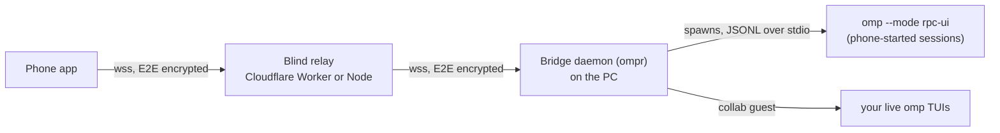

# OMP Remote

Monitor and drive your [omp](https://github.com/can1357/oh-my-pi) coding-agent sessions from your phone: see which sessions are working,
waiting for you, or done; approve tool prompts and answer `ask` dialogs; chat, steer and interrupt; start new sessions on your PC while
you are away; attach images and files. No VPN: the phone and the PC both connect **out** to a small relay, and everything between them
is end-to-end encrypted.



| Dir | What | Docs |
|---|---|---|
| [`protocol/`](protocol) | Typed message shapes, reference crypto, **cross-language test vectors** | [`docs/PROTOCOL.md`](docs/PROTOCOL.md) |
| [`relay/`](relay) | Blind WebSocket relay (Cloudflare Worker + Durable Object, or Node) | [`relay/README.md`](relay/README.md) |
| [`bridge/`](bridge) | `ompr`: the PC daemon, pairing, session supervision, attention inbox | [`bridge/README.md`](bridge/README.md) |
| [`android/`](android) | Native Kotlin + Compose app (the reference client) | [`android/README.md`](android/README.md) |

Porting to another platform? Start with [`docs/PORTING-IOS.md`](docs/PORTING-IOS.md).

## Security in one paragraph

A paired phone can start sessions and answer approvals, which means a leaked phone key is **remote code execution on your PC**. Each device gets its own key
(P-256 ECDH + HKDF at pairing, re-authenticated with fresh ephemeral keys on every connection, AES-256-GCM frames, per-direction replay counters). The relay only sees ciphertext, room ids and sizes.
Pairing needs a one-time link plus a 6-digit code compared on both screens. `yolo` approval mode is off by default. `ompr revoke <id>` cuts a device off immediately.
Details and known limits: [`bridge/README.md`](bridge/README.md#security-model). An independent review was done and its findings fixed; the code has not had an outside audit.

## Quick start (PC)

Needs [omp](https://github.com/can1357/oh-my-pi) installed, and Node 26 (the code runs `.ts` directly; it has only been run on Node 26).

```sh
cd relay  && npm install && npx wrangler login && npx wrangler deploy   # free Cloudflare plan; prints your wss:// URL
cd ../bridge && npm install
node src/cli.ts init --name "My PC"        # then put your relay URL in ~/.config/ompr/config.json  ("relays": [...])
node src/cli.ts install-service            # prints the systemctl commands to enable the always-on daemon
node src/cli.ts pair                       # prints a QR + link, valid 10 minutes, single use
```

Build and install the app: see [`android/README.md`](android/README.md). Without Cloudflare you can run the Node relay on any host: [`relay/README.md`](relay/README.md).

## Status

Verified on real hardware (Pixel 7) and an emulator, against real omp:

- pairing by QR (with the confirmation code) and automatic reconnect;
- starting a session from the phone, approvals, `ask` dialogs, steer/queue/interrupt, image and file upload, tool-result images;
- attaching to a live TUI session and prompting it from the phone;
- the Cloudflare Worker, deployed and contract-tested over real TLS.

Tests: bridge 209, relay 24, Android 51, plus shared crypto vectors that every client must reproduce.

**Peer sync** (`peer` in the bridge config, `ompr sync`) mirrors sessions, image blobs and project folders to an always-on second PC over SSH + rsync, so a session can be continued from the phone while the main PC is off.
The planner and the project-folder guard are unit-tested. A live run against a second machine pushed 74 real sessions (254 transcripts, 10,118 blobs, identical counts on both sides) and the next run was incremental.
Opening a mirrored session on the second machine from the phone has not been tried yet: that machine still needs its own omp login. Details and rules: [`bridge/README.md`](bridge/README.md#peer-sync-keep-working-while-this-pc-is-off).

**Phone-as-agent-tools** (location, clipboard, notifications, camera; every tool Off until the user enables it) work end to end on a Pixel 7 against real omp: the agent sent a
notification, read a real location fix, wrote and read back the clipboard, and received and described a camera photo. A call that arrives while the app is closed posts a notification that
opens the confirmation. The bridge half is also covered by a live script (`bridge/e2e/live-hosttools.ts`). Testing on the device found and fixed three bugs (the connection died while the system
camera was open; no notification was posted if the app left the screen while a confirmation was pending; a "Recent" session that a live terminal still held could be opened a second time).

**Not done / not verified:** push notifications (FCM code exists but is untested without a Firebase project), voice (`live.*`), the biometric lock on
real hardware, wake-on-LAN (the PC must be awake), and anything iOS.

## License and credits

[MIT](LICENSE). This is an independent project and is not affiliated with omp. It uses omp's RPC mode and the `omp collab` commands; the collab wire format was
reimplemented from omp's own MIT-licensed source (see `bridge/src/tui/`).

This software lets a paired phone run commands on your PC. Read the security model above before using it, and report vulnerabilities privately through this
repository's **Security → Report a vulnerability** page rather than in a public issue.
